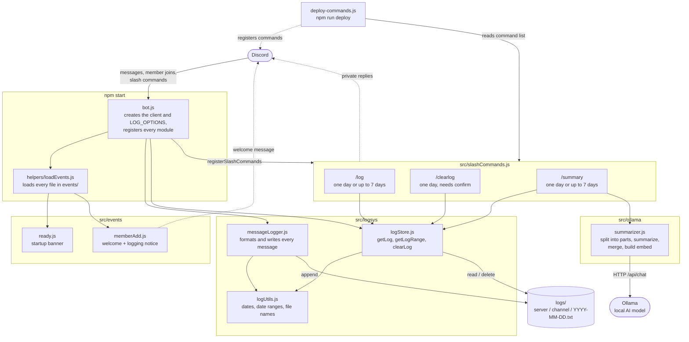

# Archive Bot: system diagram
 

 
**How to read it**
 
- **Solid arrows** are calls or data flowing inward. **Dotted arrows** are messages going back out to Discord.
- **`bot.js`** starts everything. It loads the event files through `loadEvents`, starts `messageLogger`, creates the `logStore`, and registers the slash commands.
- **Writing logs:** `messageLogger` is the only part that writes to `logs/`. It uses `logUtils` for timestamps and file names.
- **Reading logs:** every slash command goes through `logStore`. It's the only part that reads or deletes log files, and it uses the same `logUtils` helpers, so it always looks where the logger wrote.
- **Summaries:** `/summary` gets the text from `logStore`, then passes it to `summarizer`, which is the only part that talks to Ollama.
- **`deploy-commands.js`** isn't part of the running bot. You run it separately to register the slash commands with Discord.