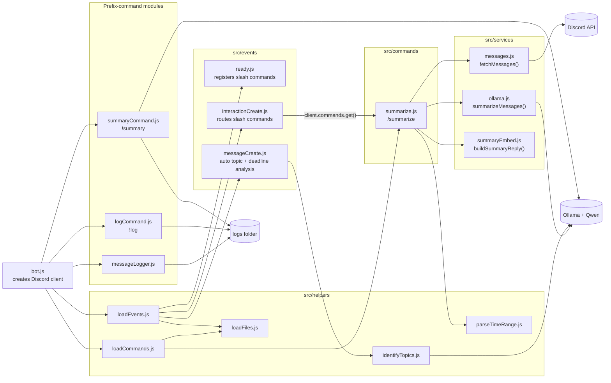
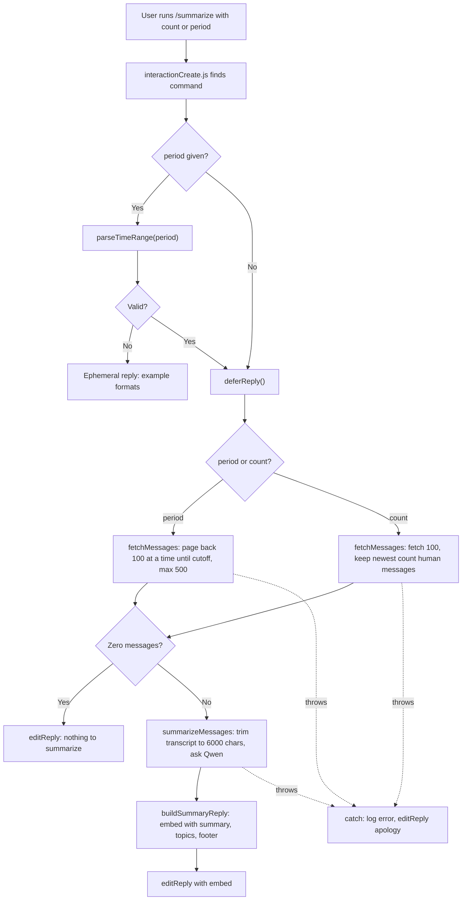
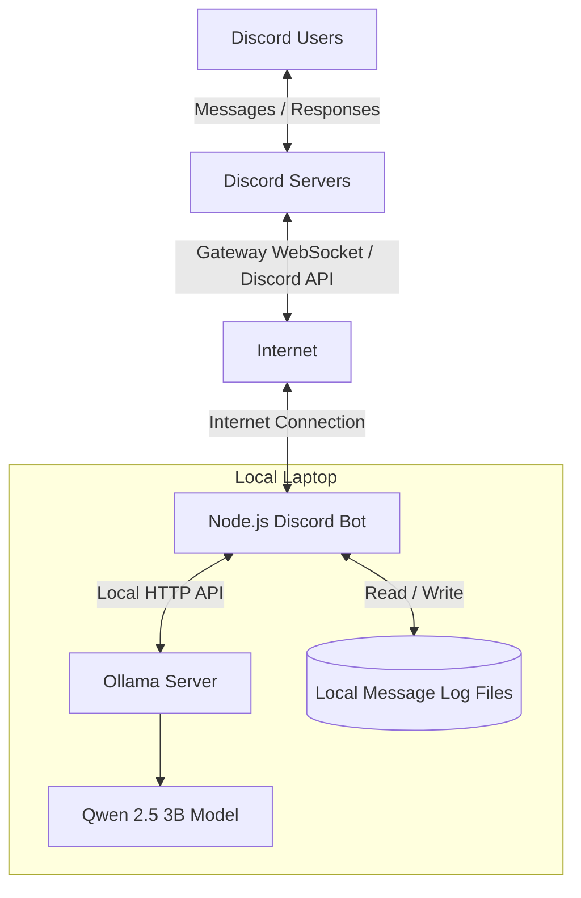
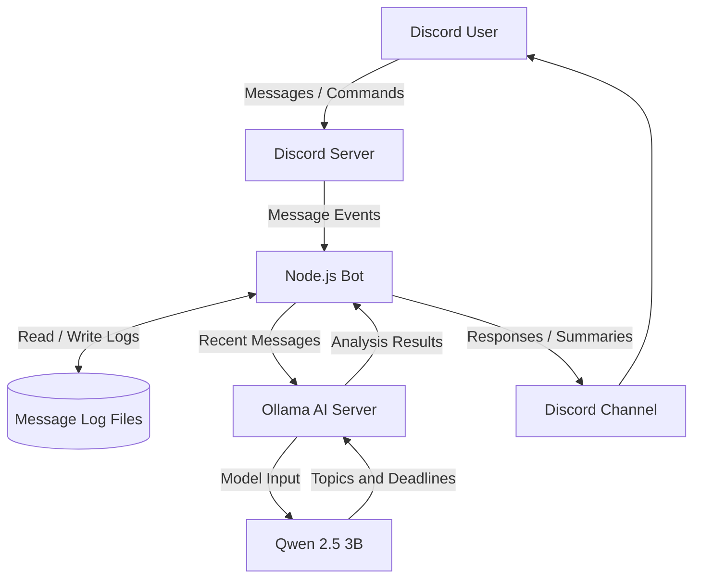
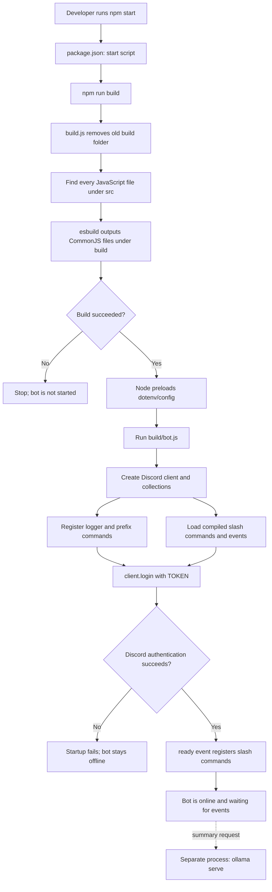
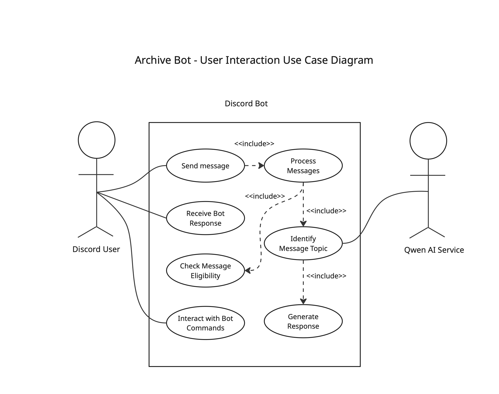
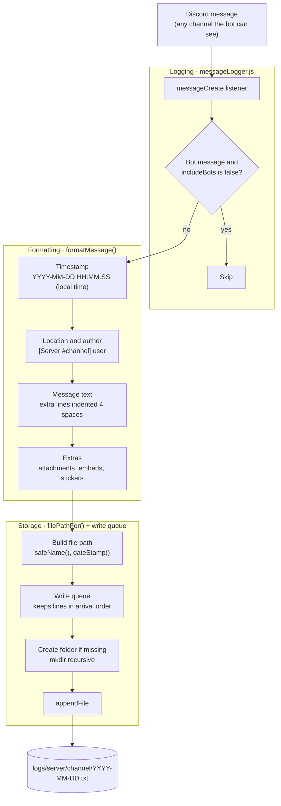
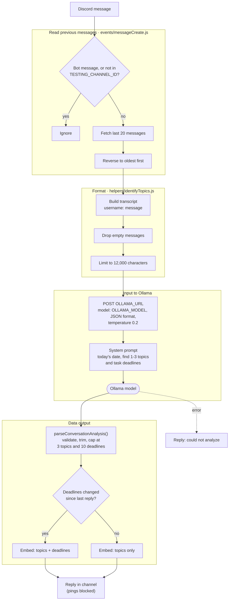

## Code Architecture

### Module structure

`src/bot.js` is the entry point. It registers features in two ways:

1. **Folder-loaded modules.** `loadCommands.js` and `loadEvents.js` read every `.js` file in `src/commands/` and `src/events/` and attach it to the Discord client. Slash commands like `/summarize` work this way.
2. **Register-function modules.** `messageLogger.js`, `logCommand.js`, and `summaryCommand.js` each export a `register(client, options)` function that `bot.js` calls directly. These handle message logging and the `!log` / `!summary` prefix commands.

`/summarize` follows a **command → services** pattern. The command file handles only Discord interaction logic: options, deferring, replying, and errors. The real work happens in three services, each with one job:

| Module | Responsibility |
|---|---|
| `services/messages.js` | Fetch channel history (by count or by time span), drop bot and empty messages, return `{ content, author, timestamp }` oldest-first |
| `services/ollama.js` | Build a size-limited transcript, send one request to Qwen, parse `{ summary, topics }` |
| `services/summaryEmbed.js` | Turn the result into a Discord embed |
| `helpers/parseTimeRange.js` | Turn text like `"last hour"` or `"3h"` into milliseconds (max 1 week) |

The services are passed into `execute()` through a `deps` object, so the unit tests in `tests/summarize.spec.js` can swap in fakes and never call Discord or Ollama.



### `/summarize` control flow

If the `period` text is invalid, the command replies privately right away. Otherwise it calls `deferReply()`, because Discord only allows 3 seconds to respond and Qwen can take a minute or more. After deferring, it has 15 minutes to edit in the answer.



### Adding a new slash command

1. Create a file in `src/commands/` that default-exports `{ data, execute }`, where `data` is a `SlashCommandBuilder`.
2. Put reusable logic (fetching, AI calls, formatting) in `src/services/` so it can be tested on its own.
3. Restart the bot. `loadCommands.js` picks up the file, and `ready.js` registers it with Discord (instantly if `GUILD_ID` is set).


## Network Architecture - Spencer

## Overview

Our Discord bot uses a client-server architecture. Discord acts as the external platform where users interact with the bot, while a local laptop hosts the Node.js application and Ollama AI server.

The Node.js application uses discord.js to communicate with Discord over the internet. It receives messages and commands, processes them, and sends responses back to Discord. The bot also communicates with Ollama through a local connection on the same laptop. Ollama runs the Qwen 2.5 3B model, which analyzes recent Discord messages to identify discussion topics and deadlines.

The bot also uses local files to store message logs, which can be retrieved using commands.

## Network Diagram

The network diagram shows how the different components communicate with each other. Discord users interact with Discord's servers, which communicate with the Node.js bot over the internet. The bot then communicates with the locally hosted Ollama server and accesses local message log files.



### Network Communication

- **Discord:** Provides the platform where users send messages and interact with the bot.
- **Internet:** Connects Discord's servers to the locally hosted bot.
- **Node.js:** Processes incoming Discord events and commands and determines how the bot responds.
- **discord.js:** Handles communication between the Node.js application and Discord.
- **Ollama:** Provides a locally hosted API that allows the bot to communicate with the AI model.
- **Qwen 2.5 3B:** Analyzes recent Discord messages to identify topics and deadlines.
- **Local Message Log Files:** Store messages that the bot can retrieve when users request previous conversations.

## Data Flow Diagram

The data flow diagram illustrates how information moves through the bot when users interact with it. Messages are received through Discord, processed by Node.js, and stored or sent to Ollama when AI analysis is needed.



### Data Flow Explanation

1. A user sends a message or command in a Discord channel.
2. Discord delivers the message event to the Node.js bot.
3. The bot processes the event and can save or retrieve messages from local log files.
4. When AI analysis is needed, the bot sends recent messages to Ollama.
5. Ollama passes the information to the Qwen 2.5 3B model for analysis.
6. The model returns its analysis, including identified topics and deadlines.
7. The Node.js bot processes the results and sends the appropriate response to Discord.

## Hosting and Deployment

The bot and Ollama server run locally on a laptop rather than on a cloud server. Node.js runs the bot application, while Ollama hosts the AI model.

npm is used to install the project's dependencies and run the application. The bot uses discord.js to connect to Discord and Ollama's local API to communicate with the AI model.

Because the application is hosted locally, the laptop must remain powered on, connected to the internet, and running the bot for it to be available to Discord users.

## Architectural Considerations

| Component | Advantages | Limitations |
|---|---|---|
| Local Ollama Server | Does not require an external AI API. | Requires local computing resources. |
| Local Hosting | Avoids cloud hosting costs. | Bot becomes unavailable when the laptop is offline. |
| Node.js | Handles asynchronous events and Discord commands. | Requires Node.js and project dependencies. |
| Local Message Storage | Allows previous messages to be retrieved. | Logs are stored on the host machine. |


## Startup Architecture (`npm start`) - Emma part

`npm start` first builds the source code, then starts ArchiveBot using settings from `.env`.

The command in `package.json` is:

```text
npm run build && node -r dotenv/config build/bot.js
```

The `&&` is an important boundary. Node starts the bot only if the build succeeds. This prevents the application from running an incomplete build after a compilation error.

### Startup sequence

1. `npm start` invokes the `start` script in `package.json`.
2. `npm run build` executes `node build.js`.
3. `build.js` deletes the previous `build/` directory, recursively finds every JavaScript file under `src/`, and passes those files to esbuild.
4. esbuild preserves the directory structure while translating the source modules into CommonJS files under `build/`. For example, `src/events/ready.js` becomes `build/events/ready.js`. CommonJS output is required because the runtime loaders use `require()` to discover commands and events by file path.
5. If the build succeeds, Node preloads `dotenv/config`. This reads `.env` before `build/bot.js` accesses `process.env`.
6. `build/bot.js` creates the Discord client, registers the logger and prefix-command modules, creates the command and event collections, and loads the compiled files in `build/commands/` and `build/events/`.
7. `client.login(TOKEN)` authenticates with Discord and opens the gateway connection.
8. When Discord emits `ready`, `ready.js` publishes the loaded slash-command definitions. With `GUILD_ID`, commands are registered to one server and update quickly; without it, they are registered globally.
9. The Node process remains active and waits for Discord events. Stopping this process takes the bot offline.



### Configuration and external dependencies

ArchiveBot reads configuration at runtime rather than compiling it into `build/`. So, secrets remain outside Git, and the same build can run with different Discord servers or Ollama models.

| Setting or service | Role |
|---|---|
| `TOKEN` | Required by `client.login()`; a missing or invalid token prevents the bot from connecting to Discord. |
| `GUILD_ID` | Optional server ID used by `ready.js` for fast, server-specific slash-command registration. |
| `CHANNEL_NAME` | Selects the channel used by the welcome-message feature. |
| `TESTING_CHANNEL_ID` | Limits automatic topic and deadline analysis to the configured channel. |
| `OLLAMA_URL` | HTTP endpoint used for ai model. |
| `OLLAMA_MODEL` | Names the Ollama model, currently `qwen2.5:3b`. |
| Ollama | A separate local service. `npm start` does not launch it. The bot can start without Ollama, but requests fail until `ollama serve` is running and the model is installed. |

---

## Data Architecture

Archive Bot has two message-processing pipelines that run side by side:
 
1. **Message logging** saves every message to daily text files.
2. **Recent-message analysis** reads the latest messages in a test channel, sends them to the local Ollama model, and replies with the topics and deadlines it finds.
Both listen to Discord's `messageCreate` event, but they don't share code or data.

## User Interaction Architecture — Vicky

Users interact with ArchiveBot through Discord channels and commands. Discord delivers user messages and command interactions to the bot, which processes them and determines the appropriate response.

Users can interact with the bot in two main ways:

- **Messages:** When a user sends a message in the configured testing channel, the bot automatically analyzes recent channel messages using the local Qwen model to identify discussion topics and deadlines.
- **Commands:** Users can use slash commands such as `/summarize` and prefix commands such as `!log` and `!summary` to request summaries or retrieve previously logged messages.

The bot communicates results back to users through Discord channel messages, replies, and embeds. If an error occurs during processing, the bot can send an error response instead.

### User Interaction Use Case Diagram

The use case diagram illustrates the main ways users interact with ArchiveBot, including sending messages, using commands, receiving responses, and the bot's interaction with the Qwen AI service.


 
### 1. Message logging system
 
Every message the bot can see is formatted into one line of text and appended to a daily file for its channel.
 

 
**Example log line**
 
```
[2026-11-05 14:03:22] [My Server #general] alice: are we still on for Friday?
    I can book the room
```
 
 
### 2. Recent-message analysis system
 
Every human message in the configured test channel triggers an analysis of that channel's latest 20 messages.
 

 
---
 
