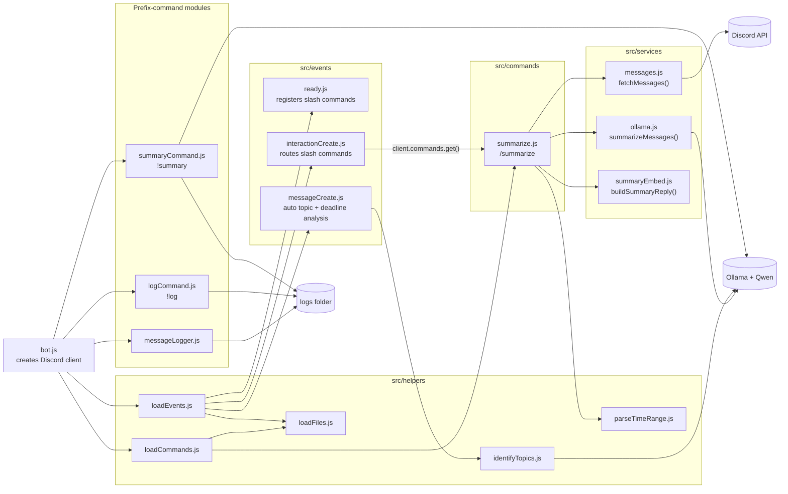
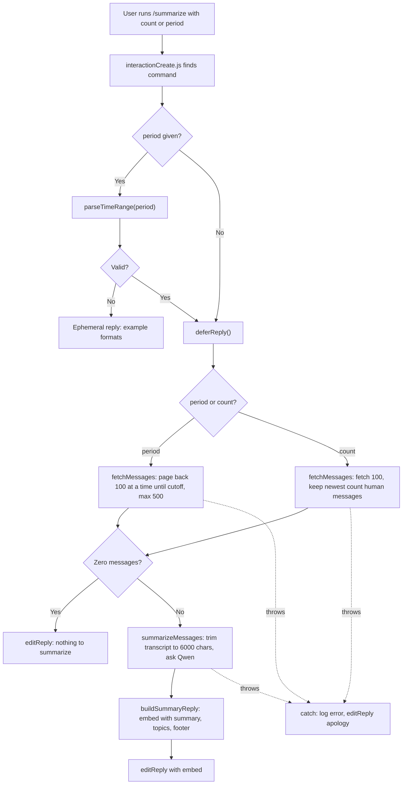

## Code Architecture

### Module structure

`src/bot.js` is the entry point. It registers features in two ways:

1. **Folder-loaded modules.** `loadCommands.js` and `loadEvents.js` read every `.js` file in `src/commands/` and `src/events/` and attach it to the Discord client. Slash commands like `/summarize` work this way.
2. **Register-function modules.** `messageLogger.js`, `logCommand.js`, and `summaryCommand.js` each export a `register(client, options)` function that `bot.js` calls directly. These handle message logging and the `!log` / `!summary` prefix commands.

`/summarize` follows a **command → services** pattern. The command file handles only Discord interaction logic: options, deferring, replying, and errors. The real work happens in three services, each with one job:

| Module | Responsibility |
|---|---|
| `services/messages.js` | Fetch channel history (by count or by time span), drop bot and empty messages, return `{ content, author, timestamp }` oldest-first |
| `services/ollama.js` | Build a size-limited transcript, send one request to Qwen, parse `{ summary, topics }` |
| `services/summaryEmbed.js` | Turn the result into a Discord embed |
| `helpers/parseTimeRange.js` | Turn text like `"last hour"` or `"3h"` into milliseconds (max 1 week) |

The services are passed into `execute()` through a `deps` object, so the unit tests in `tests/summarize.spec.js` can swap in fakes and never call Discord or Ollama.

### `/summarize` control flow

If the `period` text is invalid, the command replies privately right away. Otherwise it calls `deferReply()`, because Discord only allows 3 seconds to respond and Qwen can take a minute or more. After deferring, it has 15 minutes to edit in the answer.

### Adding a new slash command

1. Create a file in `src/commands/` that default-exports `{ data, execute }`, where `data` is a `SlashCommandBuilder`.
2. Put reusable logic (fetching, AI calls, formatting) in `src/services/` so it can be tested on its own.
3. Restart the bot. `loadCommands.js` picks up the file, and `ready.js` registers it with Discord (instantly if `GUILD_ID` is set).